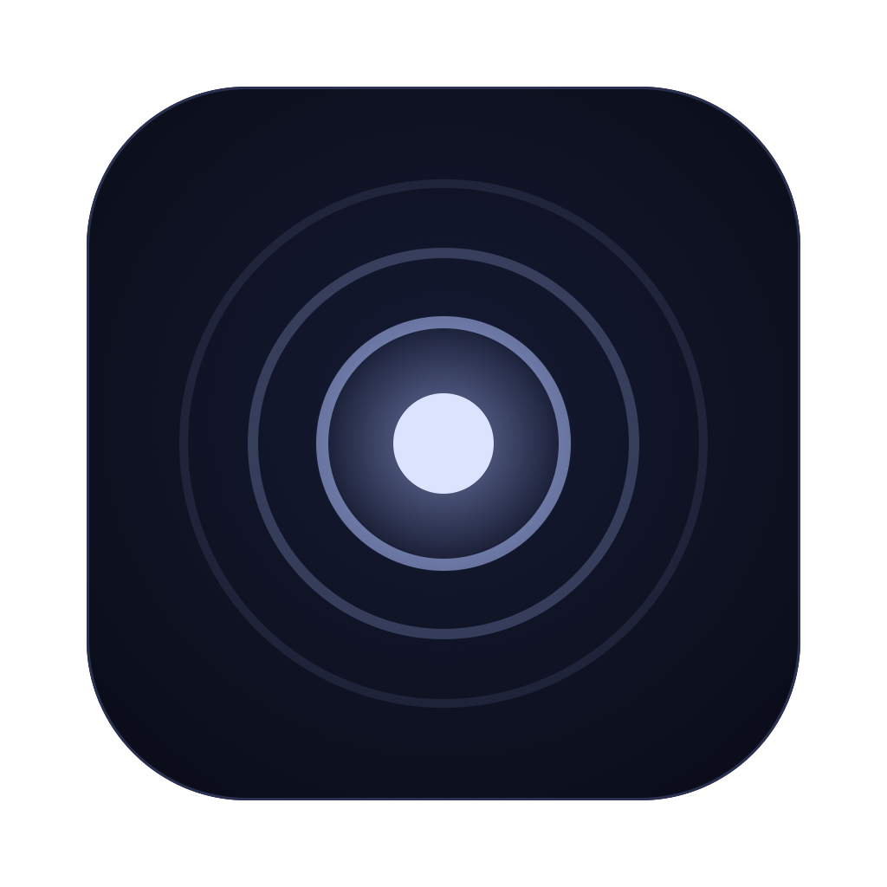
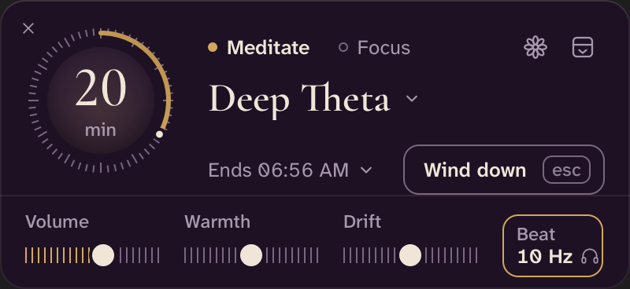
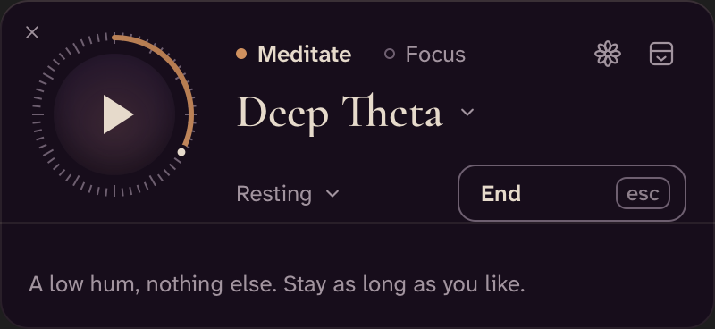
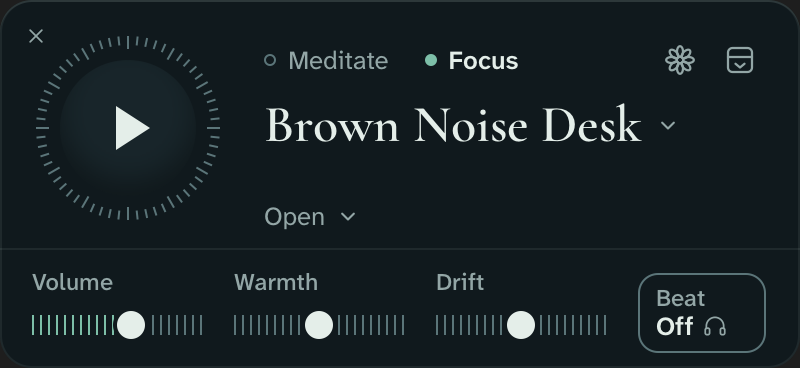
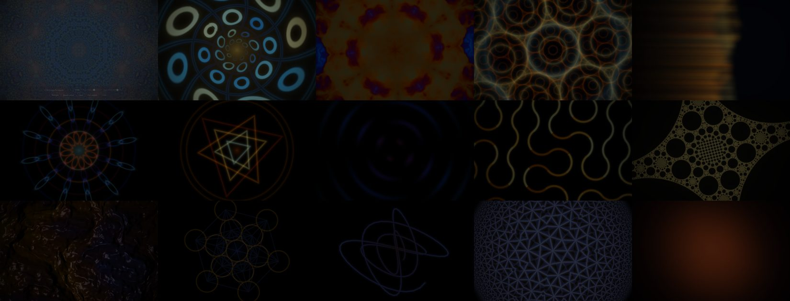
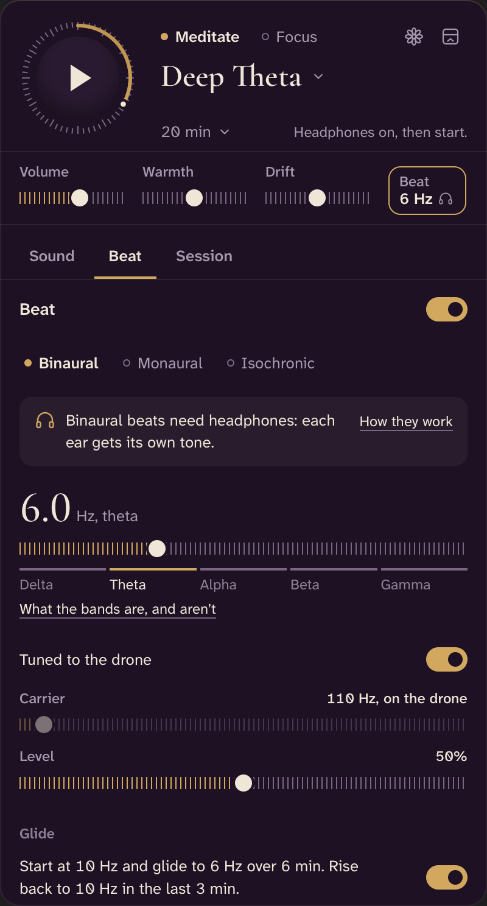
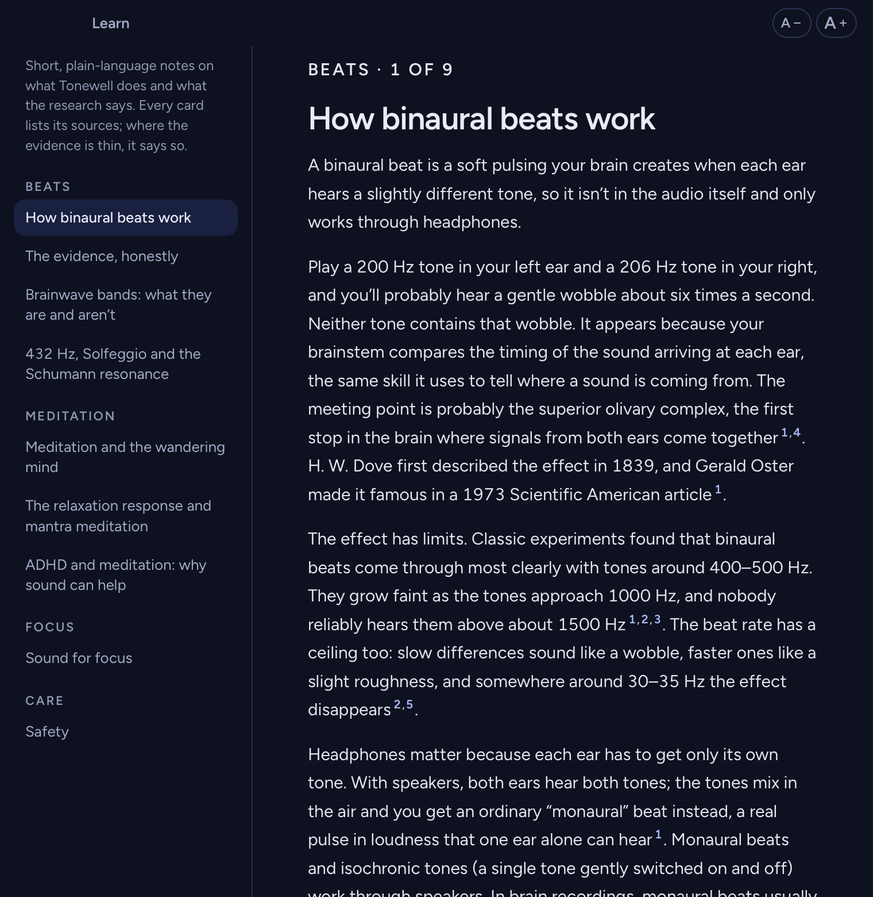

<p align="center">
  
</p>

<h1 align="center">Tonewell</h1>

<p align="center"><em>A small music box from another realm, for sitting still and for getting things done.</em></p>

<p align="center">
  
</p>

Tonewell plays an endless, slowly changing bed of sound: a warm drone that
wanders between nearby notes, breath-like noise, sparse bells, and optional
binaural beats, rain, ocean or a plain noise bed. Nothing repeats and nothing
is recorded. Every sound is made on your Mac as it plays.

It was made for one person first: someone with ADHD who meditates twice a
day and can't do total silence. A continuous, not-quite-musical sound gives
the restless part of attention somewhere soft to rest while the mantra does
the work. The same need turns up at the desk, so there's a Focus mode for
hours of unobtrusive sound alongside your other apps.

## What it's like

- **A mini player and the menu bar.** Tonewell lives in a 400 × 184 window
  you can tuck in a corner, or in the menu bar with no window at all.
- **Wind it up.** The round well is the play button and the timer. Drag
  around it to wind the session in 5-minute steps, then click to start.
  It runs down once a minute, never ticking seconds at you.
- **One way to stop, and it's gentle.** Wind down (or Esc) settles
  everything into a low, warm hum in about six seconds and waits there.
  Resume or End when you're ready. Nothing ever cuts off. The keyboard's
  play/pause key and a press on AirPods do the same, so you can come down
  without opening your eyes.
- **Meditate and Focus.** Meditate has a wandering drone, bells and a
  theta beat that glides down from alpha. Focus is steadier: noise beds,
  rain, a still drone, no bells, no beat unless you ask.
- **Two knobs that matter.** Warmth (warm to bright) and Drift (still to
  wandering), both centered on the preset as designed. Everything else is
  one click away in the panel: every layer, the beat, the session.
- **Honest about binaural beats.** The Learn window explains what they
  are, what the research does and doesn't show, and where folklore like
  432 Hz comes from, with sources you can check.
- **Optional visuals.** Fifteen slow scenes in their own window, six
  palettes, a breath pacer, brightness that never changes faster than
  three times a second, and a Calm mode on by default. With no visuals
  window open, nothing renders.
- **Kind to work.** Focus presets are steady and barely use the CPU (about
  1% of one core for Brown Noise Desk). Turn on "Soften during calls" and
  the sound dips whenever an app is using a microphone.
- **Private by construction.** No accounts, no network, no analytics.
  Settings, presets and an optional session log (date, length, preset; no
  streaks) stay in one file on your Mac.

<p align="center">
  
  &nbsp;
  
</p>

<p align="center">
  
</p>

<p align="center">
  
  &nbsp;
  
</p>

## The sound

| Layer | What it is |
|---|---|
| Drone | Five detuned voices (sawtooth blending to triangle) through a resonant lowpass swept every half-minute or so, plus a sine sub an octave down. The root wanders (A, F, G, E by default), gliding between notes. |
| Beat | Binaural (one tone per ear), monaural (works on speakers) or isochronic. The carrier sits on a harmonic of the drone. Glides from one beat to another over minutes, and back up at the end. On speakers, binaural plays as monaural automatically. |
| Breath | Pink noise through a band-pass that rises and falls like air. |
| Bells | Sine partials on ratios of the current root, panned at random, with a soft echo. |
| Voices | A wordless synthesized choir: soft voices singing vowels (oo, oh, ah, eh, a hummed mm) on the drone's chord, breathing between phrases. Never words, so never competing with a mantra. Off by default; on in Journey. |
| Textures | Brown, pink and white noise; rain; ocean swell; wind; a shimmer of high harmonics; an endless Shepard rise. All generated live. |
| Space | A generated convolution reverb in four sizes, stereo width and slow auto-pan. |
| Drift | Lets the filter, breath, bells and space wander within bounds, so the sound keeps changing without anyone touching it. |

Safety is built into the signal chain: S-curve fades, a 12 dB-per-second cap
on volume rises, a limiter and a soft clipper. When headphones disconnect,
Tonewell mutes at once instead of switching to your speakers.

## Building it

You'll need [Rust](https://rustup.rs), Node 20 or later, and Xcode's command
line tools.

```sh
npm install
npm run tauri dev       # run the app with live reload
npm run tauri build     # build Tonewell.app
npm run dmg             # wrap it in a disk image
```

The app isn't signed or notarized yet, so the first time you open a build
from elsewhere, right-click it and choose Open.

Checks:

```sh
npm test                # unit tests (Vitest)
npm run test:audio      # renders the real engine in WebKit and checks levels,
                        # beat frequencies, glides, wind down and fades
npm run perf            # rough CPU cost of each layer
npm run screenshots     # regenerates the screenshots above
```

[docs/listening.md](docs/listening.md) says what to listen for when checking
the sound by ear.

macOS (Apple Silicon) is the first target. The code is cross-platform Tauri,
with the macOS-only parts (output-device watching, the menu-bar template
icon) behind platform checks, so Windows and Linux builds should work but
haven't been tried.

## How it's put together

- `src/audio` is the engine: one parameter table, the layers, an
  AudioWorklet for textures, and a lookahead scheduler on the audio clock.
- `src/session` holds the session: start, wind down, resume, end, timers,
  device changes.
- `src/ui` is the mini player, the well, the panel and the menu-bar menu.
- `src/visuals`, `src/learn` and `src/settings` are the other windows.
- `src-tauri` is the native shell: menu bar, keep-awake, output watching,
  window lifecycle.

The reasoning behind the bigger choices is in
[docs/decisions.md](docs/decisions.md).

## Credits

- The visuals' four original scenes and the sound's first shape come from
  the Chrysanthemum prototype, kept in [`prototype/`](prototype/).
- Type: [Cormorant Garamond](https://github.com/CatharsisFonts/Cormorant)
  by The Cormorant Project Authors and
  [Atkinson Hyperlegible Next](https://github.com/googlefonts/atkinson-hyperlegible-next)
  by the Braille Institute of America, both under the SIL Open Font License
  (copies in `src/fonts/`).
- Built with [Tauri](https://tauri.app).

Tonewell isn't affiliated with any meditation organization and doesn't teach
a technique. It isn't a medical device. If you have epilepsy or a history of
seizures, read the Safety card in Learn before using the visuals.

## License

[MIT](LICENSE) © 2026 Seth Atwood
